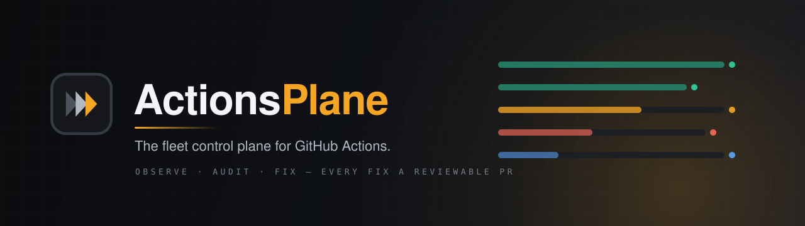

<div align="center">



<br>

**Observe, audit, and fix GitHub Actions across hundreds of repositories — from one self-hosted UI, API, and CLI.**
Every fix ships as a reviewable pull request.

[](https://github.com/shpak-e/Actionsplane/actions/workflows/ci.yml)
[](LICENSE)


</div>

> [!WARNING]
> **🚧 Preview — not production-ready.** ActionsPlane has not yet been validated against a real GitHub org
> end-to-end. Do not point it at production repositories. Evaluate in a sandbox only; interfaces and schema may
> change without notice.

---

## Why

If your team owns 30+ repositories, GitHub Actions gives you no fleet view. You get:

- **Status fragmentation** — N browser tabs to know if builds are green.
- **Supply-chain blindness** — unpinned actions and over-broad `GITHUB_TOKEN` scopes, invisible until an incident (tj-actions, trivy-action…).
- **Workflow drift** — the same workflow copy-pasted everywhere, slowly diverging.
- **Fix toil** — every deprecation or pinning push means N checkouts, N edits, N PRs, by hand.

Existing tools each cover a fragment: scanners find problems in one repo, bots bump versions, dashboards show metrics. ActionsPlane combines **observe + audit + fix** in one loop — and every change it makes lands as a pull request, never a push.

## What it does

**🔭 Observe** — a GitHub App streams `workflow_run`/`workflow_job` webhooks into Postgres (HMAC-verified, deduped, with a polling reconciler as safety net). One dashboard shows live runs across every repo, with per-workflow metrics (success rate, p50/p95 duration, flakiness) and a **Pipelines** graph that maps cross-repo trigger chains (`workflow_run`, reusable workflows, dispatch) — down to the failing step of a broken pipeline.

**🔍 Audit** — workflows are parsed into a typed AST and checked continuously: unpinned actions, missing/over-broad `permissions:`, deprecated actions, missing `concurrency:`, unverified publishers. Findings have a lifecycle, roll up into a per-repo posture scorecard, and upload as SARIF to GitHub Code Scanning (resolved findings close their alerts).

**📐 Drift** — register a canonical workflow template, bind repos to it, and get structural AST diffs (identical → minor → content → structural) instead of noisy text diffs. See exactly which of 120 repos diverged from the golden release workflow, and how badly.

**🔧 Fix** — bulk **campaigns**: pick an operation (e.g. *pin every action to its commit SHA*), preview a per-repo **dry-run diff**, then apply — ActionsPlane opens a branch + PR per repo with comment- and format-preserving YAML edits (`ruamel` round-trip). Apply is double-gated (opt-in flag + operate token), reuses the dry-run-resolved SHAs so the reviewed diff is exactly what lands, and every write is recorded in an append-only audit log.

**✅ Verified-closed** — a campaign doesn't just open PRs, it **proves the fix landed**. At create it snapshots the findings it targets; after the PRs merge, re-auditing the repos confirms which are actually resolved — the campaign reports *"resolved 41/47"* with a per-repo breakdown, so you can see fleet posture move, not just PR counts. **Export evidence** downloads a tamper-evident compliance bundle (printable HTML report + machine-readable JSON + SHA-256 manifest) for any campaign.

**No GitHub App? Offline mode** pulls workflows/runs for any list of public repos over the public API — full dashboard, no webhooks. And `actionsplane audit local .` scans a local checkout as a CI gate (non-zero exit on findings).

## Quickstart

**Fastest — prebuilt images, nothing to build.** Pulls the four component images from GHCR and (by
default) keeps them auto-updated as new versions ship:

```sh
docker compose -f deploy/docker-compose.ghcr.yml pull
docker compose -f deploy/docker-compose.ghcr.yml up -d

open http://localhost:3001        # dashboard
open http://localhost:8000/docs   # API
```

> If the images are still private (they are until first published & flipped to Public), `docker login
> ghcr.io` first — see [deploy/README.md](deploy/README.md#the-images).

**Or build from source** (the dev sandbox):

```sh
# full local stack: Postgres + Redis + API + ingestor + worker, auto-migrated
docker compose -f deploy/docker-compose.full.yml up --build

# demo data, no GitHub App needed:
PYTHONPATH=src python scripts/seed_local.py
```

**Or for iterating on the code:**

```sh
make install   # uv sync
make up        # Postgres + Redis
make migrate && make test && make lint
make api       # + make ingestor / make worker (host-run, fast reload)
```

To ingest **real repositories**, create a GitHub App and install it on the repos you want (permissions and webhook setup are documented in `.env.example`) — or use offline mode for public repos, no App needed.

```sh
# CLI highlights
actionsplane audit local .                          # scan a local repo, CI-gate friendly
actionsplane audit all                              # fleet audit via the API
actionsplane campaign preview --op pin-shas --file  # what would change, before anything changes
actionsplane campaign create / status               # run the campaign
```

## Deploy

Four paths — Compose (build-from-source or prebuilt+auto-reload), Kubernetes via kustomize
(`deploy/k8s/`) or Helm (`deploy/helm/actionsplane/`) — all covered in **[deploy/README.md](deploy/README.md)**,
including how the GHCR images are built (`edge` on every `master` push, semver on tags) and how to
enable auto-updates (Watchtower for Compose, Keel for k8s). Ships hardened by default: non-root
read-only containers, default-deny NetworkPolicies, Redis auth, ingress TLS, two-tier API tokens
(operate/read-only).

## How it's built

FastAPI + SQLAlchemy (async) + Postgres + Redis/arq worker; React + Vite + TanStack Query frontend with SSE live updates; Typer CLI; optional OpenTelemetry tracing end-to-end. 340+ hermetic tests incl. hypothesis property tests on the YAML-edit engine.

**Design principles:** GitHub App, never PATs · webhooks first, polling only as reconciliation · **all edits via PRs**, never a direct push · AST, not regex — edits preserve comments and formatting · fail-closed write gates · self-hosted, no SaaS dependency.

## Project status & roadmap

v1 feature-complete and hardened in a local sandbox, with live validation against a real GitHub org proven end-to-end. Recent work: the **verified-closed loop** (campaigns prove their fixes landed), a fleet **Cost/time** view with optimization advice, a **SHA-pin readiness** lane, an in-app **Activity** trail, **Drift → template-sync** campaigns, notifications (Slack/webhook/email), and a GHCR image pipeline with auto-reload. Next: continuous advisory watch, consumer-graph/blast-radius incident mode, and compliance evidence export.

## Contributing

Issues and PRs welcome once the project exits preview. Until then: `make test && make lint` must pass; the CI dogfoods ActionsPlane's own rules (all third-party actions SHA-pinned).

## License

Apache-2.0 — see [`LICENSE`](LICENSE).
